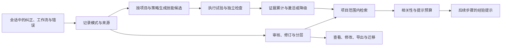

# Runtime Self-Learning Harness 6.2.8

### 自学习与长期记忆

**让反复确认的偏好、项目事实和任务经验，成为 Agent 下一次工作时可用的上下文。**

[下载 v6.2.8](https://github.com/326sun/runtime-self-learning-harness/releases/tag/v6.2.8) · [查看源码](https://github.com/326sun/runtime-self-learning-harness/tree/v6.2.8) · [自动化验证](https://github.com/326sun/runtime-self-learning-harness/actions/workflows/ci.yml)

Runtime Self-Learning Harness 是面向 DeepSeek Harness 的本地自学习与记忆插件。它观察任务中的纠正、重复工作流和工具错误，将经验整理为可检索、可审核、可修订的记忆，并在后续模型调用前提供与当前项目相关的提示。

长期使用时，你可以查看系统记住了什么、经验来自哪里、适用于哪个项目，以及某条技能是否经过实际执行和独立检查。自学习发生在记忆、经验提示与技能管理层，积累的知识由你查看和管理。

## 为什么使用它

多轮协作经常需要重复说明输出习惯、项目约定和已经排查过的问题。长期记忆要发挥作用，还需要解决召回、过期、冲突、跨项目误用和效果验证。这个插件将这些环节放在同一条可检查的链路里。

| 你遇到的问题 | 插件提供的能力 |
| --- | --- |
| 新会话需要重新说明习惯 | 从纠正中积累偏好，通过审核与门槛判断后供后续任务使用 |
| 同一个问题反复排查 | 保存错误经验与处理线索，在相关任务中检索召回 |
| 多个项目的约定和错误相似 | 按项目限制私有记忆召回，技能候选和验证证据也按项目区分 |
| 新事实出现后，旧信息仍在干扰 | 保留有效时间、修订历史与替代关系，区分当前事实和历史信息 |
| 不清楚某条记忆为何形成 | 回查学习回合的任务摘要、工具摘要与结果信号 |
| 记忆越积越多，上下文越来越拥挤 | 核心记忆按相关性与预算提示，归档经验通过显式搜索调用 |
| 工具执行成功被误认为技能有效 | 将技能展示、策略应用与结果验证分开，按候选专用验收条件累计证据 |

## 核心能力

### 从日常协作中积累经验

原生插件自动观察会话中的用户消息、工具调用、工具结果和助手回合，识别重复工作流、纠正与失败模式。正常使用时，无需每个回合手动提交学习记录。

学习得到的信息仍受重复次数、评分、审核状态和项目范围约束。插件注入的提示通过消息来源与真实用户输入区分，避免将自己的提示误学成用户偏好。

例如，你可以积累“文档使用中文”“这个项目的测试步骤”“某类工具错误应先检查哪些条件”等经验，再通过工具检查和修订它们。

### 记忆可以查看、修改与撤回

长期记忆支持偏好、事实、项目状态、工作流、错误和事件等类别。你可以搜索、读取正文、查看修订历史与来源，也可以明确要求新增、修改或逻辑删除某条记忆。

事实保留有效起止时间、获知时间与新旧替代关系，方便回查“当时是什么”和“现在是什么”。删除会隐藏当前可用记录；旧日志及已有备份需要单独管理。

### 按项目召回，按预算使用

原生会话的项目范围从当前工作目录推导。检索和自动提示遵循项目范围与治理门槛，技能候选进一步按项目、任务、动作、错误、根因和策略区分，减少不同项目之间的经验混用。

| 层级 | 主要内容 | 使用方式 |
| --- | --- | --- |
| `core` | 稳定偏好、有效事实、项目状态 | 符合审核与治理条件的相关条目，可在 Token 预算内参与自动提示 |
| `archive` | 过程经验、历史信息、低频知识 | 通过显式检索按需调用，保留长期查阅价值 |

已激活技能也先按当前项目筛选，再应用数量和 Token 预算。经验提示需要结合当前任务判断，用户当前指令始终优先。

### 中文友好的本地检索

检索融合 CJK BM25、多查询 RRF、显式实体与别名关系、字符 n-gram 等信号，支持中文、英文和混合表达。实体关系来自记忆中明确保存的信息，字符信号帮助补充短词和部分拼写差异的召回。

默认检索在本机完成，无需额外部署向量数据库或配置 embedding 服务。

### 来源可追溯，迁移可预览

学习回合生成受限的 episode 来源记录，保存任务和工具摘要、项目范围、结果信号与不透明的会话哈希。记忆中的来源引用可回查到这些记录；episode 不保存原始对话正文。

备份使用版本化 JSON。导入遵循“预览 → 检查冲突 → 导入 → 逐条批准”的流程：预览与同一份导入数据和当前数据版本绑定，同 ID 内容不直接覆盖，导入项先进入待审核状态，事实替代需要单独批准。

### 技能按验证证据晋升

重复失败可以形成技能候选，候选需要经过执行试验和独立检查后才能累计晋升证据。默认达到 5 次可信成功进入暂存阶段（staged），达到 7 次进入激活阶段（active）；已验证的回归会触发降级并移出激活注册表。

**技能被展示、策略被执行、结果通过验收，是三个独立状态。** 工具未报错、技能被注入或调用者自报 `verified: true` 都不会直接增加成功计数。

维护者为候选配置项目、完整策略、工具参数和独立验收条件。插件对照同一会话、同一回合中的原生工具事件，核验调用顺序、参数和 JSON 结果断言，生成可追溯且去重的证据凭据。验证契约未配置时，记忆学习与候选生成仍然工作，普通成功回合不会推动技能晋升。

激活后的技能默认参与后续步骤的上下文提示。技能文件同时可渲染到数据目录，自动提示通过原生事件接入。配置与试验流程见[技能验证说明](docs/SKILL-VERIFICATION.md)。

## 它如何工作



原生接入使用 `session/event` 观察任务过程，使用 `agent/created` 初始化上下文，通过 `agent/pre-step` 在模型调用前加入记忆和已激活技能。观察与反馈按 Session ID 关联，并单独维护 Agent 与 Session 的映射。

## 安装与开始使用

当前版本为 **v6.2.8**。需要 **Node.js 24.9+**；包声明的 DeepSeek Harness 版本范围为 **`>=0.1.0-rc.6 <0.3.0`**。声明的版本范围与真实宿主验收范围见下文。

使用原生插件命令安装：

```powershell
dsh plugin --profile web add github:326sun/runtime-self-learning-harness
```

1. 按实际使用的 profile 调整命令中的 `web`，安装完成后重启对应 profile。
2. 调用 `learning_status`，确认插件可用并查看实际 `dataDir`、观察回合、模式和技能数量。
3. 正常使用 Agent；需要时要求它搜索已有经验，或列出记忆并查看来源。原生模式自动观察和注入，无需首次手动调用工具激活。
4. 需要验证技能时，由维护者先配置[候选验收条件](docs/SKILL-VERIFICATION.md)，再运行候选试验。

本项目遵循官方 DSH bundle 格式：`package.json` 中的 `dsh.bundle.patch` 指向 `cordis.patch.yml`，由宿主加载插件。Release 提供 ZIP、TGZ 与校验和，可用于版本留存和核对。

## 常用工具

原生 bundle 注册 **18 个工具**，包括 12 个记忆工具与 6 个学习工具。

| 记忆工具 | 用途 |
| --- | --- |
| `memory_search` / `memory_list` | 搜索经验、列出当前范围内的记忆 |
| `memory_get` / `memory_history` | 读取正文、查看修订历史 |
| `memory_provenance` / `memory_episodes` | 回查记忆来源、浏览学习回合摘要 |
| `memory_upsert` / `memory_delete` | 显式新增、修改或逻辑删除记忆 |
| `memory_approve` | 批准具体待审记忆 |
| `memory_export` | 导出记忆备份 |
| `memory_preview_import` / `memory_import` | 预览冲突，再导入同一份数据 |

| 学习工具 | 用途 |
| --- | --- |
| `learning_status` | 查看运行状态、数据目录、模式与技能数量 |
| `learning_observe` | 手动提交受限回合，用于诊断或离线回放 |
| `learning_inject` | 预览查询和项目对应的记忆与技能提示 |
| `learning_skill_evolve` | 运行技能候选演化，支持预览晋级判断 |
| `learning_skill_feedback` | 开启候选试验，核验策略执行与独立检查结果 |
| `learning_skill_render` | 将模式和已激活技能渲染到数据目录 |

列出当前范围内的核心记忆，调用 `memory_list`：

```json
{ "memoryLayer": "core", "limit": 20 }
```

搜索历史处理经验，调用 `memory_search`：

```json
{ "query": "权限错误的处理经验", "memoryLayer": "all", "limit": 5 }
```

拿到实际记忆 ID 后，调用 `memory_provenance` 查看来源：

```json
{ "id": "<实际记忆 ID>" }
```

预览候选晋级判断，调用 `learning_skill_evolve`：

```json
{ "options": { "dryRun": true } }
```

该预览仍会刷新派生模式与技能文件；它适合检查候选和门槛，使用前应了解会产生这些数据写入。

配置验证契约后，先调用 `learning_skill_feedback` 开启试验：

```json
{ "phase": "begin", "candidateId": "<当前候选完整 ID>" }
```

Agent 在同一会话、同一回合内执行契约指定的策略及独立检查后，再调用同一工具：

```json
{ "phase": "complete", "candidateId": "<当前候选完整 ID>", "trialId": "<begin 返回的 trialId>" }
```

插件根据宿主实际记录的执行与检查结果判定成功或回归，调用参数无需也不能用成功布尔值替代证据。完整约束见[技能验证说明](docs/SKILL-VERIFICATION.md)。

## 数据与默认行为

原生模式优先使用宿主分配的 `ctx.dataDir`，备份以 `learning_status` 返回的实际 `dataDir` 为准。回退目录为 `<HARNESS_HOME>/self-learning-harness/`；未设置 `HARNESS_HOME` 时为 `~/.harness/self-learning-harness/`。

主要数据文件如下；具体文件会随功能使用创建：

```text
<dataDir>/
├── patterns.json
├── episodes.jsonl
├── experience_log.jsonl
├── activity_log.jsonl
├── skill_candidates.json
├── active_skills.json
├── skill_verification_contracts.json   # 维护者配置；默认不创建
├── action_feedback.jsonl
├── skill_verification_receipts.jsonl
└── generated/skills/self-learning/SKILL.md
```

| 功能 | 默认行为 |
| --- | --- |
| 数据与检索 | 本地存储、本地检索，插件默认不调用外部模型、不上传原始对话 |
| 会话观察与记忆提示 | 原生模式自动接入；提示受项目、审核状态、相关性与预算约束 |
| 归档记忆 | 按需显式检索 |
| 技能成功计数 | 需要候选专用验证契约、实际策略调用与独立检查凭据 |
| 已激活技能提示 | 默认开启，按项目筛选后应用数量和 Token 预算 |
| 工作区自动修复与命令执行 | 适配层关闭自动动作执行；试验中的工具调用由 Agent 通过宿主执行 |
| 导入与事实替代 | 先预览、再导入、逐条批准，事实替代单独审核 |

episode 的精简策略只针对来源摘要；其他学习日志与用户导出仍需按实际内容管理。进入上下文的经验会随正常模型请求交给宿主配置的模型，调用与数据传输遵循宿主配置。

验证凭据记录满足了维护者选定的验收条件，验收覆盖面取决于验证器本身。拥有本地文件写权限的主体仍可修改配置和数据，这套机制不提供文件系统权限之外的隔离。

## MCP 兼容入口

也可以将仓库中的 `server.js` 作为独立 MCP stdio 服务使用。在源码目录安装依赖并启动：

```powershell
npm ci
node server.js
```

在支持 MCP 的客户端中配置对应的 Node 命令和 `server.js` 绝对路径。独立入口支持用 `HARNESS_DATA_DIR` 指定数据目录、用 `HARNESS_PROJECT` 指定项目。

MCP 入口提供 **12 个记忆工具**。自动观察、自动注入及技能演化依赖原生 Harness 的事件与 Agent 接口，使用这些能力请安装原生 bundle。

## 版本与验证范围

当前版本的源码与发布附件以 [v6.2.8](https://github.com/326sun/runtime-self-learning-harness/releases/tag/v6.2.8) 为准。以下为发布时的验证记录，可查看[公开 CI 运行](https://github.com/326sun/runtime-self-learning-harness/actions/runs/41048515705)：

| 检查 | 记录结果 |
| --- | --- |
| 自动化测试 | Windows 与 Linux 的 Node.js 24 环境均为 25 项通过 |
| 生产依赖审计 | 当次 `npm audit --omit=dev` 为 0 漏洞 |
| 包内容与版本检查 | 通过，包括 bundle 配置、必要文件、版本一致性和产品独立性 |

测试覆盖记忆管理、原生工具注册、实际 DSH 消息工厂生成的工具结果、自动提示、跨项目与跨策略聚类、Session 关联、候选晋升与回归、伪造及重复反馈拒绝、旧证据隔离和已激活技能提示。测试中的会话流程主要使用模拟宿主事件。

真实 Harness 安装、多轮模型对话、项目切换和长期运行的端到端验收尚未完成。声明的版本兼容范围与上述自动化结果不代表这些场景已经验收。

从 v6.2.7 升级时，旧候选和宽松成功计数会备份到 `skill_candidates.pre-evidence-v2.json` 并退出激活注册表。历史失败经验按项目重新生成候选，从零积累新版验证证据；记忆数据保留。

## 开发与许可

```powershell
git clone https://github.com/326sun/runtime-self-learning-harness.git
cd runtime-self-learning-harness
npm ci
npm test
npm audit --omit=dev
npm run check:package
```

[GitHub Actions](https://github.com/326sun/runtime-self-learning-harness/actions/workflows/ci.yml) 在 Windows 与 Linux 的 Node.js 24 环境运行测试、生产依赖审计和包内容检查。技能验证的配置格式、试验生命周期与证据边界见[开发说明](docs/SKILL-VERIFICATION.md)。

采用 [MIT License](LICENSE)。
